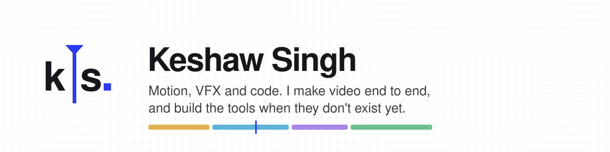

### Hi, I'm Keshaw 👋

I've spent 10,000+ hours moving pixels: 21 feature film credits in VFX and compositing, four and a half years of motion design at [Supra](https://supra.com/), and now I lead video at [neo.work](https://neo.work/).

I write code when the tool I need doesn't exist yet. Usually that means motion tools, AI-assisted creative pipelines, and product prototypes I design and build myself.

### What I'm building

| Project | What it is | Stack | Live |
|---|---|---|---|
| [dot-motion-tool](https://github.com/k4keshaw/dot-motion-tool) | Browser tool for dot-matrix motion graphics: noise patterns, grid, speed and dot controls | JavaScript | [Open ↗](https://dot-motion-tool.vercel.app) |
| [Morphic Studio](https://github.com/k4keshaw/Morphic_studio_mvp) | MVP for an AI-assisted motion studio | TypeScript | |
| [Claude Reply Suggester](https://github.com/k4keshaw/xyz-reply-app) | Type `/` in an X or LinkedIn comment box to get AI reply suggestions | HTML, Claude API | [Open ↗](https://xyz-reply-app.vercel.app) |
| [Relay Web3 wallet](https://github.com/k4keshaw/WalletDesign) | Web3 + Web2 payments app, designed and built as a working prototype | TypeScript | [Open ↗](https://wallet-design-alpha.vercel.app) |
| [Finflow dashboard](https://github.com/k4keshaw/Fintech_Stablecoin_product_dashboard_design) | Stablecoin treasury dashboard: balances, payments, convert | TypeScript | [Open ↗](https://stablecoinproductdashboarddesign.vercel.app) |
| [Fireflies agenda](https://github.com/k4keshaw/Fireflies_meeting_agenda) | Live progression line concept for an AI meeting assistant | TypeScript | [Open ↗](https://firefliesmeetingagenda.vercel.app) |

### Where the code started

From artist to technologist, one script at a time:

**After Effects and Flash scripting** → **Maya rigging** → **Houdini** → **Python** rigging scripts and custom tools → **compositing** for feature films → **OpenCV and computer vision** → **AI**

Some animation can't be keyed by hand, so I learned to script it. Compositing taught me what happens to every pixel behind the scenes, and in 2020 I started rebuilding it in code with OpenCV and Python: [compositing](https://www.linkedin.com/pulse/i-did-digital-compositing-opencv-python-keshaw-thakur-/), [masking](https://www.linkedin.com/pulse/i-can-hide-face-code-d-keshaw-thakur-/), [cropping](https://www.linkedin.com/pulse/i-cropped-image-code-yeah-keshaw-thakur-/) and [computer vision](https://www.linkedin.com/pulse/moving-towards-computer-vision-ai-keshaw-thakur-/). That move from artist to tech gave me a solid foundation for both.

### Tools

**Creative:** Nuke · After Effects · Houdini · Cinema 4D · Redshift · Maya · RealFlow · Blender · Photoshop
**Code:** JavaScript · TypeScript · Python · OpenCV · HTML/CSS · Vercel
**AI:** Claude · agent workflows · AI video and compositing tools

### Find me

[keshawsingh.com](https://www.keshawsingh.com) · [LinkedIn](https://www.linkedin.com/in/k4keshaw/) · [Instagram](https://www.instagram.com/k4keshaw/) · [X](https://x.com/k4keshaw) · [IMDb](https://www.imdb.com/name/nm8751429/)
